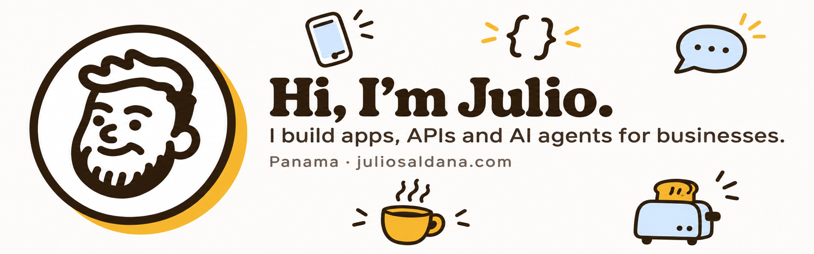

  <a href="https://juliosaldana.com">
    <picture>
      <source media="(prefers-color-scheme: dark)" srcset="assets/profile-dark.png">
      
    </picture>
  </a>

  
  
  
  

I build apps, APIs and AI agents for businesses in Panama and anywhere with Wi‑Fi. I take the idea all the way to production, and I stick around when something breaks on a Friday.

> 🟡 **Now:** building the AI ordering assistant at [CLAU.IO](https://clau.io). On the side I run SoftwareToaster and XYZ Solutions, as long as the coffee holds out.

## ✦ What I do

<table>
<tr>
<td width="33%" valign="top">

**📱 Apps and web**

Flutter for mobile; React, Next.js and Vite for the web. From screen design to cloud deploy.

</td>
<td width="33%" valign="top">

**🔌 Backend and integrations**

Node.js, NestJS and Python. APIs, Odoo, point of sale, e‑invoicing and anything that needs to talk to everything else.

</td>
<td width="33%" valign="top">

**🤖 AI and automation**

Agents, MCP servers, OpenAI, Genkit and n8n. The AI suggests; the business rules live in the application.

</td>
</tr>
</table>

## ✦ Things I've built

Each one with an honest label of where it stands. No "100% done" when it only runs on my laptop.

<table>
<tr>
<td width="50%" valign="top">

**AI ordering assistant** · CLAU.IO 

Takes orders through conversation and turns them into real cart actions on the kiosk. Every action is validated before it touches the cart.

Flutter · TypeScript · Node.js · OpenAI · Genkit · Cloud Run

</td>
<td width="50%" valign="top">

**ToastLink** · SoftwareToaster 

Conversation agents, visual workflows and a shared inbox so a person can step in when needed. With spending and loop limits, because agents get excited too.

TypeScript · Next.js · NestJS · PostgreSQL · Redis · MCP

</td>
</tr>
<tr>
<td width="50%" valign="top">

**ToastCast** · SoftwareToaster 

Digital signage with the catalog synced from the point of sale, playlists and cached playback. AI-assisted design always goes through human review.

TypeScript · Cloudflare Workers · D1 · R2 · Kotlin

</td>
<td width="50%" valign="top">

**Odoo and POS automation** · own and client projects 

Modules for loyalty points, redemptions, e‑invoicing and server‑side TOTP approvals, with events that never charge twice.

Python · JavaScript · NestJS · PostgreSQL · Redis

</td>
</tr>
</table>

## ✦ Open source

<a href="https://github.com/wincrack07/t3-orchestrator">
  <picture>
    <source media="(prefers-color-scheme: dark)" srcset="https://raw.githubusercontent.com/wincrack07/t3-orchestrator/main/assets/banner-dark.png">
    
  </picture>
</a>

**[t3-orchestrator](https://github.com/wincrack07/t3-orchestrator)**: an agent skill for [T3 Code](https://github.com/pingdotgg/t3code). It splits your work across threads, routes each task to the right model and effort, and fails over between providers when an account runs out of usage. `npx skills add wincrack07/t3-orchestrator`

## ✦ Stack

  
  
  
  
  
  
  
  
  
  
  
  
  
  
  

 

<h3 align="center">AI proposes. The application decides.</h3>

Permissions are checked at the edge, secrets don't live in the code, and if I only tested it locally, I say so.

 

<b>Experience</b>

| Years | Role | Company |
|---|---|---|
| 2025 – now | Developer | CLAU.IO · Panama |
| 2024 – 2025 | Onboarding and Project Management | CLAU.IO · Panama |
| 2023 – 2025 | CEO, Panama Division | Geek Tech Sol · Remote |
| 2023 – 2024 | IT Manager | Mundo Lotes · Panama |
| 2021 – 2023 | IT and E‑commerce | Super Remate · Panama |

Full story in the [CV](https://juliosaldana.com/cv).

---

  <b>Got something to build?</b> <a href="https://cal.com/juliosaldana">Book 30 minutes</a>. I reply faster than a Friday deploy, and with fewer scares.  
   
  Made in Panama 🇵🇦 · No toasters were harmed · <a href="https://juliosaldana.com">¿En español?</a>

